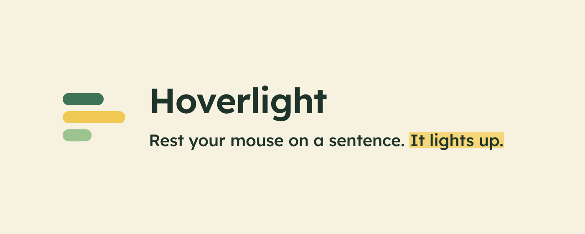
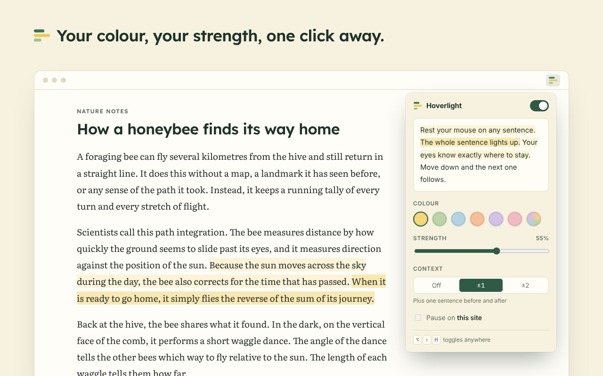

<p align="center">
  
</p>

<p align="center">
  <a href="https://cordi919.github.io/hoverlight/"><strong>Live demo</strong></a> ·
  <a href="https://chromewebstore.google.com/detail/hoverlight-%E2%80%94-sentence-rea/pggkiefgeaeoiaiikofdkokpdhlopjne"><strong>Chrome Web Store</strong></a> ·
  <a href="https://addons.mozilla.org/firefox/addon/hoverlight/"><strong>Firefox Add-ons</strong></a>
</p>

---

Hoverlight is a browser extension for people who lose their place while reading: readers with dyslexia or ADHD, people reading in a second language, or anyone whose eyes keep slipping to the wrong line.

Some readers keep a coloured overlay strip on the desk to hold their place on paper. Hoverlight brings that idea to the screen, with one difference: a strip only knows about lines, but meaning arrives in sentences. A sentence often starts mid-line and ends on the next, which is exactly where readers lose track. Hoverlight highlights the exact words of the sentence under your mouse, across the line break.



## Features

- **Hover to highlight.** Rest the mouse on a sentence and the whole sentence lights up. No clicking.
- **Context.** Optionally light the 1 or 2 sentences before and after, in a softer shade.
- **Your colour.** Six soft presets or any custom colour, with adjustable strength.
- **Handles real pages.** Works across bold text, links and line breaks; understands sentence endings in many languages (English, 中文, 日本語, …); leaves text boxes alone.
- **Out of the way.** Pause per site, or toggle everywhere with <kbd>Option/Alt</kbd> + <kbd>Shift</kbd> + <kbd>H</kbd>.
- **Leaves the page alone.** No overlay and no reader view: layout, links and text selection behave exactly as before.
- **Private.** No analytics, no accounts, no network requests. See the [privacy policy](docs/privacy.html).

## Install

**From a store** (recommended):

- [Chrome Web Store](https://chromewebstore.google.com/detail/hoverlight-%E2%80%94-sentence-rea/pggkiefgeaeoiaiikofdkokpdhlopjne): Chrome, Brave, Arc, and Edge (Edge asks you to allow extensions from other stores the first time).
- [Firefox Add-ons](https://addons.mozilla.org/firefox/addon/hoverlight/): Firefox 140 or later.

**From source** (Chrome, Edge, Brave, Arc):

1. Download this repository and unzip it.
2. Open `chrome://extensions` and turn on **Developer mode**.
3. Click **Load unpacked** and choose the `extension/` folder.

## How it works

1. `document.caretPositionFromPoint` finds the character under the pointer, and a glyph hit-test ignores margins and line gaps.
2. Text nodes in the surrounding block are joined, so sentences can cross `<b>`, `<a>` and `<em>`.
3. `Intl.Segmenter` splits the block into sentences, in the page's language.
4. The CSS Custom Highlight API paints the sentence (and its neighbours) without touching the DOM, so layout never shifts.

The core is one dependency-free file, [`extension/hoverlight.js`](extension/hoverlight.js), usable on any page:

```html
<script src="hoverlight.js"></script>
<script>
  const hl = Hoverlight.create({ color: '#f5d77a', opacity: 0.55 });
  hl.setOptions({ context: 1 }); // also light the sentence before and after
</script>
```

Add `data-hoverlight-ignore` to any element to exclude it. Design decisions and edge cases are in [ARCHITECTURE.md](ARCHITECTURE.md).

## Development

```bash
pip install -r requirements-dev.txt
playwright install chromium

python3 tests/test_core.py          # hover tests in headless Chromium
python3 scripts/build_site.py       # rebuild the website in docs/
python3 scripts/package.py          # store zips in dist/
python3 scripts/make_store_images.py  # store screenshots and tiles
```

Tests also run on every push via GitHub Actions.

```
extension/      the extension (Manifest V3)
  hoverlight.js   core: hover → sentence → highlight
  defaults.js     default settings and colour presets
  content.js      connects the core to saved settings
  popup.*         settings popup with a live preview
  background.js   keyboard shortcut and toolbar badge
site/           website sources (landing page, privacy policy)
docs/           built website, served by GitHub Pages
store/          store listing text, sample article and images
scripts/        build, package and image scripts
tests/          Playwright tests and fixture page
```

## Where it works

| Works | Doesn't work yet |
| --- | --- |
| Chrome, Edge, Brave, Arc (Manifest V3) and Firefox 140+ | Safari and mobile browsers |
| Most web pages: articles, news, docs, online textbooks | PDFs in the browser's built-in viewer (extensions can't run there) |
| Sentence boundaries in many languages via `Intl.Segmenter` | Text drawn on a `<canvas>`, such as the Google Docs editor |
| Mouse, trackpad, and tap on touch screens | Desktop apps, internal pages like `chrome://`, text inside images |

## License

[MIT](LICENSE)
